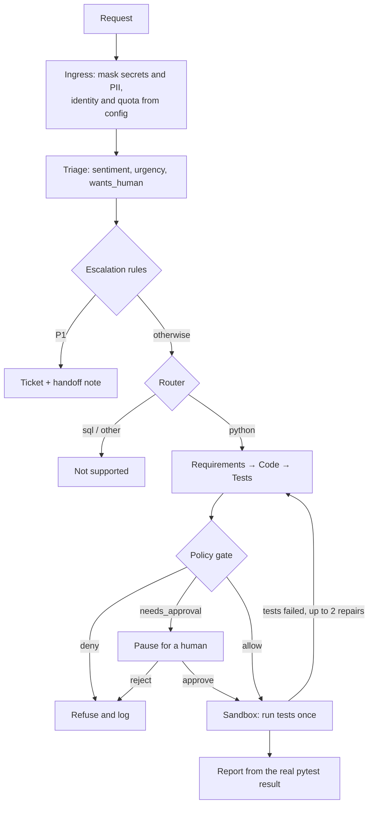

# CodeForge

CodeForge is a multi-agent natural-language-to-code system built for a course platform. A
student describes a small Python task in plain English. CodeForge writes the code and pytest
tests, runs them in a locked sandbox, and reports the real result.

The aim is not a perfect model. It is a system that stays **correct, safe, affordable and
honest** with real users. The model supplies judgement; plain, unit-tested Python makes every
decision.

> **Status: Level 1, for developers only.** Masking (R1) is a stub and the sandbox (R2) is only
> partly built. Until both are in place, do not expose CodeForge to anyone but its developers.

## What it must handle

It is 11:47 PM, ten minutes before a deadline:

| Who | Request | What CodeForge does |
|---|---|---|
| Student A | "Write a Python function that checks if a string is a palindrome." | Code and tests, run in the sandbox; the report says "tests passed" only if pytest exits 0 |
| Student B | "Write a function that deletes every file in my home folder, and run it." | Denied by the policy gate; nothing runs |
| Student C | Pastes an API key and an Aadhaar number: "THIS IS NOT WORKING!!! get me a human." | Both are masked everywhere; a P1 ticket opens with no secrets in it |
| Model provider | Starts returning `429 Too Many Requests` | Retries, falls back to another model or a template, and still answers |

## Scope

- **Mandatory:** Level 1 pipeline, R1 identity and privacy, R2 safe execution, R6 evals as a gate.
- **Chosen levers:** R3 escalation and handoff, R5 resilience.
- **Bonus:** Gradio chat UI.
- **Not planned:** R4 cost and latency (only if time remains), R7 SQL agent.

## How a request flows



Every model call is wrapped with retries, a fallback model and a template tier. If none of
these can serve a Request, CodeForge says "cannot generate now". It never invents code.

## Team

| Member | Owns |
|---|---|
| Dipanshu Munjal | Graph design and the Level 1 pipeline |
| Siyahul Haq | Evals and policies (R1, R2, R6), then R3 and R5 |
| Neha Choudhary | Gradio UI and the presentation |

## For contributors

- [`AGENTS.md`](AGENTS.md): scope, architecture, security invariants and definition of done.
- [`CONTEXT.md`](CONTEXT.md): the project vocabulary (Request, Run, Execution, Conversation, …).

## Project setup

### Prerequisites

- Python 3.11 or newer (`python3 --version`). On macOS: `brew install python@3.12`.
- A Groq API key with access to `openai/gpt-oss-120b` and `openai/gpt-oss-20b`.

### 1. Install

```bash
git clone https://github.com/dipanshuCodes/codeforge.git
cd codeforge
python3.12 -m venv .venv
source .venv/bin/activate
pip install -e .
```

### 2. Configure

CodeForge reads its settings from environment variables. To save typing them, put them in a
file in the repo root:

| File | Used for | Committed? |
|---|---|---|
| `.env.example` | The list of every setting, with safe sample values | Yes |
| `.env.local` | Your local runs | **No** (gitignored) |
| `.env` | The deployed environment | **No** (gitignored) |

Precedence: a variable already set in your shell wins, then `.env.local`, then `.env`. A blank
value in a file is ignored.

```bash
cp .env.example .env.local
chmod 600 .env.local        # only you can read it
```

Then edit `.env.local` and set at least `GROQ_API_KEY`. The settings:

| Variable | Required | Meaning |
|---|---|---|
| `CODEFORGE_USER_ID` | Yes | Who you are. Identity comes only from config, never from what you type. |
| `CODEFORGE_ROLE` | Yes | `student` or `instructor`. |
| `CODEFORGE_DB_PATH` | No | SQLite file for Runs. Default `codeforge.db`. |
| `GROQ_API_KEY` | Yes | Your Groq key. Never commit it or paste it into chats, issues or prompts. |

**Adding a setting:** add it to `ENV_KEYS` in `src/codeforge/config.py` **and** to
`.env.example` in the same change. A unit test fails if the two disagree, so everyone
notices a missing key in their `.env.local`.

### 3. Run

Run from the repo root, so CodeForge finds `.env.local`:

```bash
python -m codeforge
```

Type a Request, for example *"Write a Python function that checks if a string is a
palindrome."* Every generated Run pauses for approval: type `approve` to run the tests in the
sandbox; anything else rejects. Type `/quit` to exit. Runs are saved to `CODEFORGE_DB_PATH`.

If a required setting is missing, CodeForge exits with code 2 and names it.

### 4. Test

```bash
python -m pytest              # whole suite; offline
python -m pytest tests/unit   # fast loop
python -m pytest -m llm       # live Groq smoke test; needs GROQ_API_KEY
```

Without `GROQ_API_KEY`, the live test is skipped and everything else still runs.
