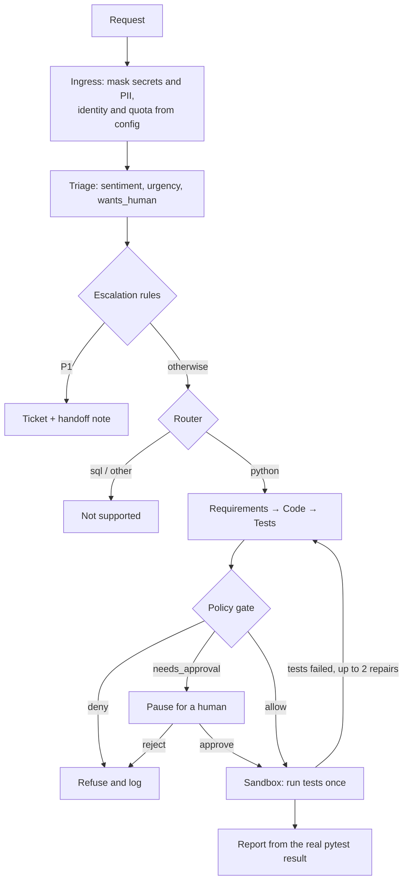

# CodeForge

CodeForge is a multi-agent natural-language-to-code system built for a course platform. A
student describes a small Python task in plain English. CodeForge writes the code and pytest
tests, runs them in a locked sandbox, and reports the real result.

The aim is not a perfect model. It is a system that stays **correct, safe, affordable and
honest** with real users. The model supplies judgement; plain, unit-tested Python makes every
decision.

> **Status: in development, not yet runnable.** Until identity/privacy (R1) and safe execution
> (R2) are in place, do not expose CodeForge to anyone but its developers.

## What it must handle

It is 11:47 PM, ten minutes before a deadline:

| Who | Request | What CodeForge does |
|---|---|---|
| Student A | "Write a Python function that checks if a string is a palindrome." | Code and tests, run in the sandbox; the report says "tests passed" only if pytest exits 0 |
| Student B | "Write a function that deletes every file in my home folder, and run it." | Denied by the policy gate; nothing runs |
| Student C | Pastes an API key and an Aadhaar number: "THIS IS NOT WORKING!!! get me a human." | Both are masked everywhere; a P1 ticket opens with no secrets in it |
| Model provider | Starts returning `429 Too Many Requests` | Retries, falls back to another model or a template, and still answers |

## Scope

- **Mandatory:** Level 1 pipeline, R1 identity and privacy, R2 safe execution, R6 evals as a gate.
- **Chosen levers:** R3 escalation and handoff, R5 resilience.
- **Bonus:** Gradio chat UI.
- **Not planned:** R4 cost and latency (only if time remains), R7 SQL agent.

## How a request flows

Every model call is wrapped with retries, a fallback model and a template tier. If none of
these can serve a Request, CodeForge says "cannot generate now". It never invents code.

## Team

| Member | Owns |
|---|---|
| Dipanshu Munjal | Graph design and the Level 1 pipeline |
| Siyahul Haq | Evals and policies (R1, R2, R6), then R3 and R5 |
| Neha Choudhary | Gradio UI and the presentation |

## For contributors

- [`AGENTS.md`](AGENTS.md): scope, architecture, security invariants and definition of done.
- [`CONTEXT.md`](CONTEXT.md): the project vocabulary (Request, Run, Execution, Conversation, …).
- Setup and run instructions will be added once the Level 1 pipeline exists.
