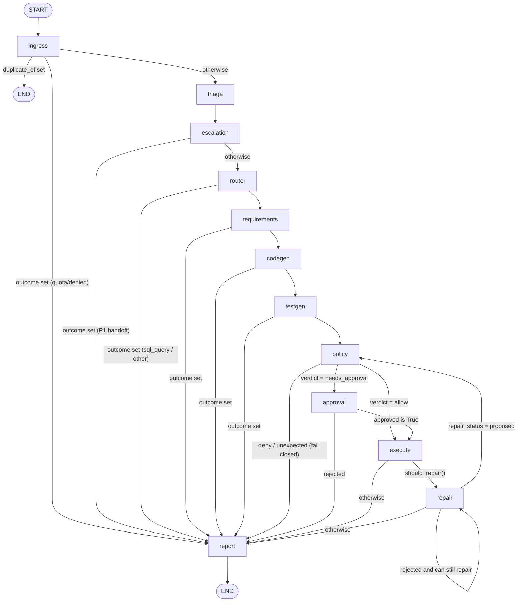

# CodeForge graph and state

Source of truth: `src/codeforge/graph/build.py` (wiring and routing) and `src/codeforge/graph/state.py` (`RunState`).
Every conditional edge routes on a typed field, never on free text. Update this file when the graph changes.

## Diagram

Every node from `escalation` to `testgen` can short-circuit to `report` once `outcome` is set. `ingress` can too.
Repaired code and tests go back through `policy`, because they are untrusted.

## How decisions are passed

Nodes never call each other. Each node returns a partial dict; LangGraph merges it into `RunState`, and the next edge function reads only typed fields from that merged state.

- **Agents propose, code decides.** A model node (`router`, `requirements`, `codegen`, `testgen`, `repair`, `triage`) gets one structured call and returns a Pydantic model. The node copies the fields it needs into state. Deterministic code (`policy/`, `reporting/outcome.py`) then sets the verdict and outcome.
- **`outcome` is the short-circuit signal.** Any node that cannot continue sets `outcome` (`quota_exceeded`, `escalated`, `unsupported`, `cannot_generate`, `denied`, `rejected`). Each `_continue_or_report` edge then sends the Run straight to `report`.
- **`verdict` picks the policy branch.** `policy` writes `verdict` (`allow` / `needs_approval` / `deny`) and `reasons`. `_after_policy` routes on `verdict` alone. Anything unexpected goes to `report`.
- **`approved` picks the approval branch.** `approval` pauses with `interrupt()` and the approver's answer is checked in code. Only the exact word `approve` sets `approved = True`.
- **`repair_status` and `repairs_tried` drive the repair loop.** `repair` sets `repair_status`. `after_repair` routes on it. `should_repair()` reads the pytest outcome, `repairs_tried`, `max_repair_attempts` and `serving_tier`.
- **`serving_tier` carries degradation forward.** Each model node sets it to the worst tier used so far in the Run. `policy` uses it to downgrade `allow` (never auto-approve), and `report` names it.
- **The pytest exit code becomes the outcome in code.** `execute` stores `execution`; `report` computes `outcome` from `exit_code` / `timed_out` via `outcome_from_execution`. Only exit 0 is `tests_passed`.
- **Persistence.** `ingress` saves an initial Run record. `report` saves the final record. Tickets and executions are saved to the SQLite store when they happen. Conversation-level counters stay in state between turns of a `thread_id`.

## What each node does

| Node | Steps | Writes to state | Can short-circuit to `report` |
|---|---|---|---|
| `ingress` | 1. Mask `raw_text` (R1) and overwrite `raw_text` with the masked text. 2. New `run_id`; `conversation_id` = `thread_id`. 3. Count today's Runs and check the quota. 4. Compute the Request key from user id and masked text. 5. If a Final Run with the same key exists, save a duplicate record and finish with its report. 6. Save the initial Run record. | `RUN_DEFAULTS` reset, `raw_text`, `request`, `run_id`, `conversation_id`, `created_at`, `request_key`; `outcome`, `report`, `duplicate_of` in the quota and duplicate cases | Yes: `quota_exceeded`. A duplicate goes to END. |
| `triage` | One model call returns language, sentiment, urgency, `wants_human`. If the model fails, assume calm. Add 1 to `unhappy_turns` for `mildly_unhappy`. | `triage`, `unhappy_turns` | No |
| `escalation` | Build `Signals` from triage and the Conversation counters. `decide_escalation` (pure rules) returns P1/P2/P3 or none. If a Ticket should open, build a masked Handoff note, add an optional small-model summary, and save the Ticket. P1 skips generation. | `escalation`, `ticket_id`, `ticket_priority`, `ticket_sla_hours`, `conversation_ticket_*`; `outcome = escalated` for P1 | Yes: P1 |
| `router` | One model call classifies the Request. An unreadable answer becomes `other`. If the model is unavailable, use `_outage`. | `kind`, `serving_tier`; `outcome = unsupported` for `sql_query` / `other` | Yes: `unsupported`, `cannot_generate` |
| `requirements` | One model call extracts function name, params, return and edge cases. Skipped on the template tier. | `requirements`, `serving_tier` | Yes: `cannot_generate` |
| `codegen` | One model call writes code. Check that the function is defined (AST). Skipped on the template tier. | `code`, `serving_tier` | Yes: `cannot_generate` |
| `testgen` | One model call writes pytest tests from the requirements and code. Skipped on the template tier. | `tests`, `serving_tier` | Yes: `cannot_generate` |
| `policy` | `evaluate_code_policy` runs on the code and the tests (AST only, nothing runs). `strictest` combines them. `degrade_verdict` stops a degraded tier from auto-approving. | `verdict`, `reasons`; `outcome = denied` on deny | Yes: deny |
| `approval` | `interrupt()` pauses the graph with the code, tests, verdict and reasons, and resumes with the approver's answer. Anything other than exactly `approve` rejects. | `approved`; `outcome = rejected` on reject | Yes: rejected |
| `execute` | Compute the Execution key from user id, code and tests. If a stored result exists, reuse it. Otherwise run `pytest` in the sandbox with the timeout, memory and output limits, and store the result. | `execution`, `attempts` | No (goes to `repair` or `report`) |
| `repair` | Attempt 1 changes code only. Attempt 2 may change code and tests. `evaluate_repair` accepts or rejects the proposal. An accepted one resets `verdict`, `reasons` and `approved`, so it faces a fresh gate. | `code`, `tests`, `repairs_tried`, `repair_status`, `repair_notes`, `serving_tier` | Yes: no usable or accepted repair |
| `report` | Compute `outcome` from the pytest result if none is set. Update the denial and failed-repair counters, and escalate if the rules say so. Render the template report (names the serving tier and model). Save the final Run record. | `outcome`, `report`, counters, any Ticket fields | n/a (goes to END) |

`_outage` (used by `router`, `requirements`, `codegen`, `testgen`): when both model tiers fail, `pick_template` looks for a strict Template match and fills requirements, code and tests with `serving_tier = template`. If nothing matches, the node opens a Ticket and sets `outcome = cannot_generate`. It never invents code.

## Routing functions

| Edge from | Function | Reads |
|---|---|---|
| ingress | `_after_ingress` | `duplicate_of`, `outcome` |
| escalation, router, requirements, codegen, testgen | `_continue_or_report` | `outcome` |
| policy | `_after_policy` | `verdict` |
| approval | `_after_approval` | `approved` |
| execute | `after_execute` | `outcome`/`execution`, `repairs_tried`, `serving_tier` via `should_repair` |
| repair | `after_repair` | `repair_status`, `should_repair` |

## State (`RunState`)

| Group | Fields |
|---|---|
| Identity and request | `raw_text`, `request` (masked), `run_id`, `conversation_id`, `created_at`, `request_key`, `duplicate_of` |
| Triage and escalation (R3) | `triage`, `escalation`, `ticket_id`, `ticket_priority`, `ticket_sla_hours` |
| Generation | `kind`, `requirements`, `code`, `tests`, `serving_tier` |
| Policy and approval | `verdict`, `reasons`, `approved` |
| Execution and repair | `execution`, `attempts`, `repairs_tried`, `repair_status` (`proposed`/`rejected`/`failed`), `repair_notes` |
| Result | `outcome`, `report` |
| Conversation-level (kept across turns of a `thread_id`) | `unhappy_turns`, `denials`, `failed_repairs`, `conversation_ticket_id`, `conversation_ticket_priority` |

`ingress` resets every per-Run field to `RUN_DEFAULTS`, so a new Request on the same Conversation never inherits the previous Run's state. The conversation-level fields are not in `RUN_DEFAULTS`, so they persist.
