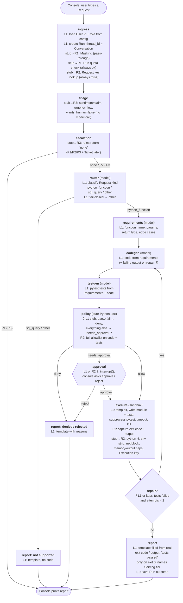

# L1 planning: what each node does

Status: draft, 2026-11-15. We refine this one node at a time.
Legend: **L1** = built now, for real. **stub** = exists now and returns a safe default; the real
version comes in the named phase. `?` = a decision we still need to make.

## Diagram

## Node by node

| # | Node | Reads | Writes | L1 | Later |
|---|---|---|---|---|---|
| 1 | ingress | raw text, config | `user`, `request` (masked), `run_id` | identity from config, Run created | R1 masking + quota, R2 Request key |
| 2 | triage | `request` | `triage` | stub: calm / low / no human | R3 model call |
| 3 | escalation | `triage`, Conversation history | `escalation` (priority or none) | stub: none | R3 rules, Ticket, Handoff note |
| 4 | router | `request` | `kind` | real model call | — |
| 5 | requirements | `request` | `requirements` | real model call | — |
| 6 | codegen | `requirements` (+ last failure) | `code` | real model call | R5 wrapper |
| 7 | testgen | `requirements`, `code` | `tests` | real model call | R5 wrapper |
| 8 | policy | `code`, `tests` | `verdict`, `reasons` | **decision needed** | R2 allowlist |
| 9 | approval | `verdict` | `approved` | **decision needed** | — |
| 10 | execute | `code`, `tests` | `execution` (exit code, output, timed_out) | real subprocess + timeout | R2 hardening, Execution key |
| 11 | repair | `execution`, `attempts` | `attempts` | **decision needed** | test-count rule, P3 |
| 12 | report | everything | `report`, saved Run | real template | Serving tier from R5 |

## Decisions to make (in order)

1. ~~**ingress:** where the Run is stored in L1.~~ **Decided:** SQLite (built-in `sqlite3`) from
   day one, in `runs/`. Every query is filtered by the config User; read functions take no user
   argument. "Missing" and "not yours" return the same result. L1 creates only the `runs`
   table; keys, quota, Tickets and Feedback tables are added in their phases.
2. ~~**router / requirements / codegen / testgen.**~~ **Decided:**
   - One model call per node, structured output as a Pydantic model, through one model factory
     in `llm/` with model names from config. No retry or fallback in L1 (that is R5).
   - Bad output (schema fails, or the code lacks the required function name) → Transient
     failure, "cannot generate now". Exception: bad router output → `other` → "not supported".
   - A fake model behind the same factory, so unit tests and hard Golden cases run offline.
   - **Models (key access checked 2026-11-15):** large = `openai/gpt-oss-120b` (all nodes);
     small = `openai/gpt-oss-20b` (Handoff summary, R5 fallback). Both in config.
3. ~~**policy stub.**~~ **Decided:** `evaluate_code_policy` in `policy/` parses code and tests
   with `ast` only. Parse failure → `deny`; everything else → `needs_approval`. Nothing runs
   without a human until the R2 allowlist replaces the "everything else" line.
4. ~~**approval.**~~ **Decided (follows from 3):** built in L1. `needs_approval` → `interrupt()`;
   the console shows the verdict, reasons, code and tests, then asks approve / reject. Reject →
   "rejected by the approver" (a Final outcome). Never a default; an empty answer is not approval.
5. ~~**execute.**~~ **Decided:**
   - **L1:** separate process `python -I -m pytest` in a fresh temp dir (deleted after); 10 s
     timeout from config, new session, whole process group killed, reported as "timed out after
     10s"; stripped env (`PATH` + temp `HOME` only, never `GROQ_API_KEY`); output cut to 10 KB.
   - **R2:** audit-hook network block; 256 MB memory cap (check that `RLIMIT_AS` behaves on
     macOS vs the Linux CI runner); Execution key; hardening Golden cases.
6. ~~**repair loop.**~~ **Decided:** the `execute → repair? → codegen` edge exists in L1, with
   `max_repair_attempts` in config set to 0. The repair logic (code-only repair 1; repair 2 may
   change tests; the rule against fewer tests or assertions) comes after R1/R2/R6 are green.
   In L1 a failing Run ends with an honest "tests failed" report.
7. ~~**report.**~~ **Decided:**
   - Outcome chosen in code: exit 0 → `tests_passed`; exit 1 → `tests_failed`; exit 2–5 →
     `tests_failed` with "did not run cleanly (pytest exit N)" (exit 5 = no tests is never a
     pass); timeout → `timed_out`; `denied`; `rejected`; `unsupported`; bad model output →
     `cannot_generate` (Transient failure).
   - Template: headline, masked Request, kind, Serving tier (+ model name), policy verdict and
     approval, pytest exit code + summary line, code, tests; output (first 10 KB) only when
     the Run did not pass.
   - `runs` table: `run_id`, `user_id`, `conversation_id`, `created_at`, `request` (masked),
     `kind`, `outcome`, `verdict`, `reasons` (JSON), `approved`, `code`, `tests`, `exit_code`,
     `timed_out`, `output`, `serving_tier`, `report`. `request_key` is added in R2.

All seven L1 decisions are settled (2026-11-15).
