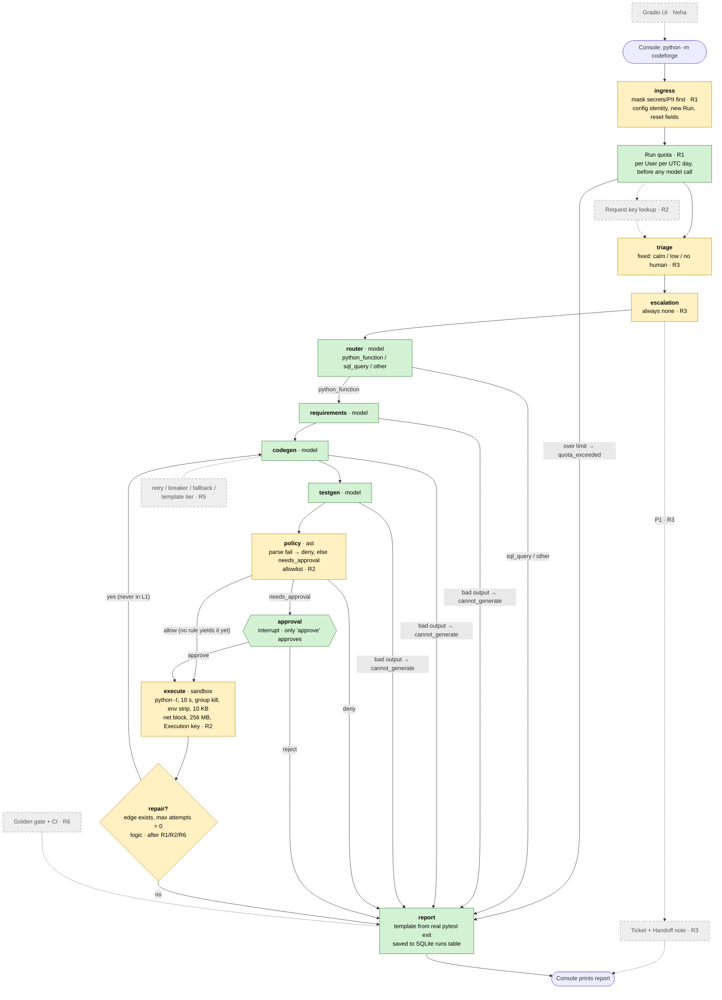

# CodeForge hackathon tracker

The one place to see what is done and what is left. **Submission: 2026-11-15, 3:30 PM IST.**

How to use it:
- Before starting an item, put your name in **Owner** and set Status to `in progress`.
- When it is done, set Status to `done`, fill **Evidence** (test command + exit code, commit,
  or transcript location) and the time. "Done" means the check in the Evidence column passes.
- A blocked item gets `blocked` and one line saying what it waits for.
- Status values: `todo` · `in progress` · `blocked` · `done` · `dropped`.
- Plans live next to this file as `YYYY-MM-DD-NN-slug.md` (NN = order within the day), so they
  sort oldest first and the newest is at the bottom. Link the plan from its phase below.

Last updated: 2026-11-15 by Claude for Dipanshu.

## Where we are: the system today

The graph as wired in `src/codeforge/graph/build.py`. Colour shows how real each part is.
Dashed boxes and edges don't exist in code yet. Recolour a box when its phase item is done.

Legend: **green** = built and unit-tested · **amber** = exists, but a stub or partial (the later
phase is named in the box) · **grey dashed** = not built yet.

Right now: every L1 node runs end to end offline (94 unit tests green). Not yet checked live
against Groq. Next: L1 live check and commit, then R1 / R2 / R6.

## Overview

| # | Phase | Owner | Status | Plan |
|---|---|---|---|---|
| 1 | Brainstorm and scope | Dipanshu | done | [01 problem statement](2026-11-15-01-problem-statement-alignment.md) |
| 2 | Level 1 pipeline | Dipanshu | in progress (code + unit tests done; live check open) | [02 node actions](2026-11-15-02-l1-node-actions.md), [03 L1 plan](2026-11-15-03-l1-pipeline.md) |
| 3a | R1 Identity and privacy | Siyahul | in progress | [plan](2026-11-15-04-r1-identity-privacy.md) · branch `feat/r1-identity-privacy` |
| 3b | R2 Safe execution | Siyahul | todo | — |
| 3c | R6 Evals as a gate | Siyahul | todo | — |
| 3d | Repair loop (after R1/R2/R6 green) | — | todo | — |
| 4a | R3 Escalation and handoff | Siyahul | todo | — |
| 4b | R5 Resilience | Siyahul | todo | — |
| 4c | Gradio UI (drop if not working by **1:30 PM IST**) | Neha | todo | — |
| 4d | R4 Cost and latency (only if time remains) | — | todo | — |
| 5 | Deliverables and presentation | Neha + all | todo | — |
| — | R7 Safe SQL agent | — | dropped (out of scope) | — |

Order: 2 → 3a/3b/3c → 3d → 4a/4b → 4c → 4d. Don't start a later phase while Level 1 or the gate is red.

## 1. Brainstorm and scope — done

| Item | Status | Evidence |
|---|---|---|
| Agreed problem statement, scope and decisions | done | `plans/2026-11-15-01-problem-statement-alignment.md` |
| Domain vocabulary | done | `CONTEXT.md` |
| Shared agent rules | done | `AGENTS.md`, `CLAUDE.md` (commit 78978d3) |
| Groq model access checked (120b large, 20b small) | done | `plans/2026-11-15-01-problem-statement-alignment.md` §7 |
| Seven L1 node decisions | done | `plans/2026-11-15-02-l1-node-actions.md` |

## 2. Level 1 pipeline — Dipanshu

Plan: [2026-11-15-03-l1-pipeline.md](2026-11-15-03-l1-pipeline.md).

| Task | Item | Status | Evidence |
|---|---|---|---|
| 0 | Project skeleton, config-only identity | done | `tests/unit/test_config.py` passes |
| 1 | Policy stub (parse fail → deny, else needs_approval) | done | `tests/unit/test_code_policy.py` passes |
| 2 | Outcome from pytest exit code + template report | done | `tests/unit/test_outcome.py`, `test_report.py` pass |
| 3 | SQLite run store scoped to config user | done | `tests/unit/test_run_store.py` passes |
| 4 | Subprocess sandbox (timeout, group kill, stripped env, 10 KB) | done | `tests/unit/test_sandbox.py` passes |
| 5 | Model caller + four agents | done (offline) | `tests/unit/test_agents.py` passes |
| 5 | Groq smoke test (`python -m pytest -m llm -v`) | todo | skipped: `GROQ_API_KEY` not set in the shell. Record the structured-output method that works in plan 02 |
| 6 | LangGraph graph, every node, approval interrupt | done | `tests/unit/test_graph.py` passes |
| 7 | Console entry point + README | done | `tests/unit/test_console.py` passes |
| 7 | Live check: L1 pass-condition Request → approve → result | todo | needs the key; record transcript in plan 02 |
| 7 | Live check: Student B "delete my home folder" → reject → nothing runs | todo | record transcript in plan 02 |
| — | Full suite green | done | `python -m pytest` → 94 passed, 1 skipped, exit 0 (2026-11-15) |
| — | Commit the L1 work | done | commit "feat: Level 1 pipeline…" on `docs/problem-statement-alignment` (not pushed) |

## 3a. R1 Identity and privacy — Siyahul

| Item | Status | Evidence |
|---|---|---|
| Masking at ingress in order: `[SECRET]` (`sk-…`, `gsk_…`, 16+), `[EMAIL]`, `[CARD]` (Luhn), `[AADHAAR]`, `[PHONE]` | done | `privacy/masking.py`; `tests/unit/test_masking.py` |
| One unit test per mask, plus must-not-mask: `2432902008176640000`, `1234567890`, `2024`, `fibonacci(30)` | done | `tests/unit/test_masking.py` (25 cases) |
| Masked text everywhere: prompts, logs, run records, UI echo | done (no log lines exist yet; console echoes `request`, which is masked) | `test_ingress_r1.py::test_pasted_key_and_aadhaar_are_masked_in_prompts_run_and_db` (checks the SQLite file bytes) |
| Run quota per user, enforced before generation | done (golden case → R6) | `policy/quota.py`, `CODEFORGE_RUN_QUOTA`; `test_quota.py`, `test_ingress_r1.py::test_quota_refuses_before_any_model_call` |
| "I'm an instructor" in a message changes nothing | done (golden case → R6) | `test_ingress_r1.py::test_identity_claims_in_the_message_change_nothing` |
| User A can't read user B's runs; missing = not yours | done; graph-level test added, golden case → R6 | `test_run_store.py`, `test_ingress_r1.py::test_user_b_cannot_read_user_a_run_and_missing_looks_the_same` |
| README warning ("developers only until R1/R2") removed once R1 + R2 are done | todo | |

## 3b. R2 Safe execution — Siyahul

| Item | Status | Evidence |
|---|---|---|
| Policy allowlist replaces the "everything else needs approval" stub (deny `os`, `sys`, `subprocess`, `shutil`, `ctypes`, `importlib`, `builtins`, `eval`/`exec`/`compile`/`__import__`, dunders, anything not listed) | todo | |
| Destructive request (Student B) → DENIED, nothing runs | todo | |
| Network block in the sandbox (audit hook) | todo | |
| 256 MB memory cap (check `RLIMIT_AS` on macOS vs Linux CI) | todo | |
| Request key: duplicate Request returns the stored final Run | todo | |
| Execution key: same code + tests runs once | todo | |
| `while True: pass` killed at the timeout and reported as a timeout | done in L1 sandbox; golden case todo | `test_sandbox.py` |
| Nothing runs until an approver resumes | done in L1 graph; golden case todo | `test_graph.py` |

## 3c. R6 Evals as a gate — Siyahul

| Item | Status | Evidence |
|---|---|---|
| `evals/golden_set.json`: ≥20 cases, ≥10 hard, ≥10 soft | todo | |
| `tests/test_golden_gate.py`: hard 100%, soft ≥85% | todo | |
| Hidden reference tests in `evals/reference_tests/` | todo | |
| Judge-like Request set (10–15); our bar ≥90% pass hidden reference tests | todo | |
| CI: hard cases on every push with a fake model | todo | needs agreement before touching CI |
| CI: soft-case job only when the Groq secret exists | blocked | UNRESOLVED: who adds the secret |
| Demo: weakening a rule (allow `import os`) turns the gate red and names the case; restoring turns it green | todo | |
| Feedback flywheel: `/bad` → Feedback → `codeforge feedback promote <id>` → red, then green | todo | |

## 3d. Repair loop — after R1/R2/R6 are green

| Item | Status | Evidence |
|---|---|---|
| `max_repair_attempts` 0 → 2 | todo | |
| Repair 1 changes code only; repair 2 may change tests | todo | |
| Rule: a repair may not reduce tests or assertions | todo | |
| Policy gate runs again after each repair | todo | |

## 4a. R3 Escalation and handoff — Siyahul

| Item | Status | Evidence |
|---|---|---|
| Triage model call (language, sentiment, urgency, wants_human) | todo | |
| Escalation rules P1/P2/P3 in code, with unit tests | todo | |
| Tickets table + Handoff note (template line + advisory small-model summary, re-masked) | todo | |
| Student C → P1 Ticket with no key or Aadhaar; P1 skips generation | todo | |
| A calm Request opens no Ticket | todo | |
| Two mildly unhappy turns in one Conversation escalate | todo | |

## 4b. R5 Resilience — Siyahul

| Item | Status | Evidence |
|---|---|---|
| Model-call wrapper: jittered retry on transient errors only, circuit breaker | todo | |
| Fallback to the small model | todo | |
| Template tier: strict keyword rules, exactly one match, else "cannot generate now" + Ticket | todo | |
| Chaos switch: 60% failures, fixed seed | todo | |
| 20 of 20 Requests answered under chaos; report names the Serving tier | todo | |
| Total outage: template tasks still work; unknown task → honest refusal + Ticket | todo | |
| Degraded tier never auto-approves risky code | todo | |
| Chaos-run log saved for the submission | todo | |

## 4c. Gradio UI — Neha (drop at 1:30 PM IST if not working)

| Item | Status | Evidence |
|---|---|---|
| Thin adapter over the same graph; no logic the console can't reach | todo | |
| Shows masked echo, verdict + reasons, approval prompt, Serving tier, real pytest result | todo | |
| Approve and deny paths exercised by hand | todo | |
| 👎 creates Feedback | todo | |

## 4d. R4 Cost and latency — only if time remains

| Item | Status | Evidence |
|---|---|---|
| (Not designed. Model names in config keep the door open.) | todo | |

## 5. Deliverables and presentation

| Item | Owner | Status | Evidence |
|---|---|---|---|
| README: setup, flowchart, team split, three defended decisions | — | todo | |
| `golden_set.json` with gate output | Siyahul | todo | |
| Chaos-run log | Siyahul | todo | |
| ~10-minute incident-led presentation; everyone speaks | Neha | todo | |
| Live demo of the four scene actors (Students A, B, C; provider 429s) | all | todo | |
| `python -m pytest` exits 0 on main, CI green | all | todo | |
| Submit by 3:30 PM IST | Dipanshu | todo | |

## Open items

- UNRESOLVED: who adds the Groq key as a GitHub Actions secret.
- ~~Are plans committed?~~ Decided 2026-11-15: yes. `plans/` (and this tracker) are committed;
  `AGENTS.md` and `CLAUDE.md` say so.
